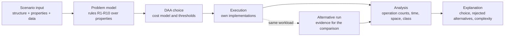

# Algorithm 2035: Autonomous DAA Decision Framework

A smart-city decision platform for the *Design and Analysis of Algorithms* framework assignment (Assignment 6, with the stress-test lab from Assignment 3).

You describe a problem by its **properties** (what the data looks like, what you need, whether items can be split, whether the data lives on disk). The framework **recognises** the problem, **chooses** a technique from the prescribed syllabus, **runs** it, and **explains** the choice, including the alternatives it rejected and the complexity class. No request ever contains an algorithm name.

**Live demo:** enable GitHub Pages (Settings, Pages, deploy from `main` / root) and open `index.html`, or just open `index.html` locally. No installation, no dependencies.

## Architecture



| Stage | Where |
|---|---|
| Scenario input, adaptation demos | `src/engine.js` (`PRESETS`, `ADAPTATIONS`), `src/app.js` |
| Problem model (recognition rules R1-R10) | `src/engine.js` (`RULES`, `recognise`) |
| DAA choice and explanation | `src/engine.js` (`SOLVERS`) |
| Data structures | `src/structures.js` |
| Algorithms | `src/algorithms.js` |
| Stress-test lab and risk rating | `src/experiments.js` |
| Correctness checks | `src/tests.js`, `tests/run-tests.js` |

More detail in [docs/ARCHITECTURE.md](docs/ARCHITECTURE.md) and the written report in [docs/REPORT.md](docs/REPORT.md).

## Syllabus coverage

| Topic | Implementation | Used for |
|---|---|---|
| Red-Black Tree | `RBTree` | in-memory ordered records |
| B-Tree | `BTree` | disk-resident ordered records |
| Binomial Heap | `BinomialHeap` | priorities when worst-case bounds matter; frontier for best-first TSP |
| Fibonacci Heap | `FibHeap` | frequent priority escalations; frontier for best-first TSP |
| Prim, Kruskal | `prim`, `kruskal` | minimum-cost network, chosen by estimated cost |
| Floyd-Warshall | `floydWarshall` | all-pairs costs; also closes missing links before TSP |
| Fractional Knapsack | `knapFractional` | divisible resources (greedy) |
| 0/1 Knapsack | `knap01` | indivisible resources (DP) |
| Matrix Chain Multiplication | `mcm` | cheapest evaluation order |
| Hamiltonian | `hamiltonian` | route feasibility (backtracking) |
| N-Queen | `nqueens` | conflict-free sensor placement (backtracking) |
| TSP | `tspBacktrack`, `tspBnBDFS`, `tspBnBBestFirst` | cheapest round trip |
| NP-Hard / NP-Complete | `CLASS` in `src/engine.js` | decision vs optimisation labels shown with every result |

## The ten recognition cases

| Rule | Request properties | Technique |
|---|---|---|
| R1 | keyed records; memory or disk | Red-Black Tree or B-Tree |
| R2 | events; share of priority raises; real-time bound; merging | Binomial or Fibonacci Heap |
| R3 | network; connect all at minimum cost | Prim or Kruskal (by density cost model) |
| R4 | network; cost between every pair | Floyd-Warshall |
| R5 | items under a budget; divisible | Fractional Knapsack |
| R6 | items under a budget; all-or-nothing | 0/1 Knapsack DP |
| R7 | chain of matrices | Matrix Chain DP |
| R8 | network; one route visiting every node once | Backtracking (Hamiltonian) |
| R9 | grid; row/column/diagonal conflicts | Backtracking (N-Queen) |
| R10 | network; cheapest round trip | Branch and Bound (TSP) |

Complexity classification is attached to every result. Adaptation demos (tab 2) show seven cases where changing one property changes the selected technique.

## Complexity labels (as used in the app)

- TSP and 0/1 Knapsack: optimisation form NP-Hard, decision form NP-Complete. The 0/1 DP is pseudo-polynomial, O(nW).
- Hamiltonian cycle/path: decision form NP-Complete.
- Standard N-Queen is **not** labelled NP-Complete; only a completion variant is known to be.
- The framework as a whole is not NP-Hard; only the combinatorial components are.

## Run, test, rebuild

```bash
node tests/run-tests.js         # 14 correctness checks, exits non-zero on failure
node scripts/generate-results.js # regenerates docs/RESULTS.md from the experiment lab
python3 build.py                 # rebuilds the single-file index.html from src/
```

Open `index.html` in a browser. Tabs: **Solve a request**, **Adaptation demos**, **Stress-test lab**, **Complexity and gaps**, **Correctness checks**.

## Experiments

The lab generates input families (sparse and dense graphs, growing chains, rising capacities, hard no-solution Hamiltonian graphs, growing TSP instances), counts operations, compares with the theoretical bound and rates each family Low, Moderate or High risk. Results: [docs/RESULTS.md](docs/RESULTS.md).

## Limitations

- Heap and tree comparisons count elementary steps and node accesses, not hardware cache or disk behaviour.
- TSP accepts at most 25 sites; above 13 only depth-first Branch and Bound runs, and it may stop at a state budget (reported as not proven optimal).
- 0/1 Knapsack refuses capacities that would need more than 40 million table cells.
- Fibonacci Heap children and roots use JavaScript `Set`s, so wall time is not a clean measure of its O(1) operations; operation counts are.

## Team

| Name | Roll number |
|---|---|
| _add team member_ | _add roll number_ |

Course: Design and Analysis of Algorithms, AI ML Leopards. Licence: MIT.
